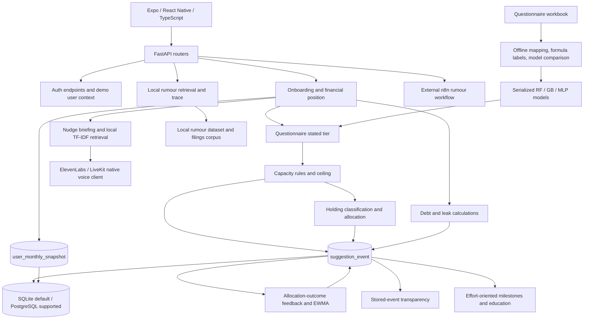

# Ability Before Willingness

## Project title

**Ability Before Willingness: An Explainable and Evidence-Aware Personal Finance Decision Support Framework**

This README describes the implementation found in this workspace. It distinguishes working application code, offline experiments, research-only prototypes, owner-reported data provenance, and information that is **NOT FOUND IN CODE**. Earlier presentation and planning documents may describe intentions that differ from the current implementation; code and saved results are treated as the source of truth here.

## 1. Project overview

This repository contains an India-focused personal-finance planning application and two related research strands:

1. A React Native/Expo client and FastAPI backend for collecting a user profile and financial records, calculating financial position, computing a questionnaire-based stated risk tier, applying a separate capacity ceiling, producing category-level allocations, and recording decisions for later inspection.
2. A questionnaire-model experiment comparing Random Forest (RF), Gradient Boosting (GB), and a scikit-learn Multilayer Perceptron (MLP) as predictors of a tier assigned by the application's own weighted questionnaire formula.
3. A rumour-verification prototype that takes an explicitly supplied market rumour and ranks a local corpus of filings, applies entity/date/source rules, and produces a candidate-by-candidate trace. A separate backend bridge can call an external n8n workflow.

The central risk-profile rule is:

```text
final_tier = min(stated_tier, capacity_ceiling)
```

In the current implementation, “willingness” means a **stated questionnaire-derived tier**, not an independently measured psychological construct. “Ability” means a rule-table ceiling based on declared financial-profile and financial-position data. The rule makes the capacity ceiling a cap: it cannot raise the questionnaire tier, and a high stated tier cannot exceed capacity.

The intended users are individuals entering their own income, expenses, debt, insurance, cash and holdings. The API and frontend are structured around an individual `user_id`. The workspace does not contain a defined participant eligibility protocol or a validated user-population description. **NOT FOUND IN CODE:** a formal target-population specification or evidence that the system is deployed for external users.

This is a decision-support and education prototype. The code does not generate named investment-product recommendations or guarantee investment returns. See the implementation of category-level allocation in `backend/app/services/allocation.py` and classification restrictions in `backend/app/services/asset_classification.py`.

## 2. Core concepts as implemented

### Ability

`backend/app/services/risk_profile.py::compute_capacity_ceiling` takes a `CapacityInputs` record assembled by `backend/app/services/risk_profile_service.py::gather_capacity_inputs`. It evaluates four components:

| Component | Input | Rule-table thresholds and component ceiling |
|---|---|---|
| Emergency buffer | Liquid cash divided by essential monthly expense, in months | `<1`: 1; `[1,2)`: 2; `[2,4)`: 3; `[4,6)`: 4; `>=6`: 5 |
| EMI burden | Total monthly EMI divided by monthly income | `>=0.50`: 1; `[0.40,0.50)`: 2; `[0.30,0.40)`: 3; `[0.20,0.30)`: 4; `<0.20`: 5 |
| Income stability | Explicit `regular` or `irregular` profile value | `irregular`: 3; `regular`: 5 |
| Life-insurance adequacy | For users with dependents only: total life cover / required cover | `<25%`: 1; `[25%,50%)`: 2; `[50%,75%)`: 3; `[75%,100%)`: 4; `>=100%`: 5 |

Required life cover is:

```text
required_life_cover = monthly_income * 12 * 10
```

Insurance is marked inapplicable when `dependents_count <= 0`. The overall ceiling is the minimum of the applicable component ceilings. All these thresholds are configured in `backend/app/services/risk_profile_config.py::CAPACITY_RULE_TABLE_V1`; its comments describe them as the application's policy, not a regulatory standard.

The actual financial-position inputs are calculated in `backend/app/services/financial_position.py`. The application stores monetary quantities in integer paise and uses `Decimal` for ratios. A zero denominator uses documented finite sentinels in the financial-position implementation, rather than `None`.

### Willingness / stated risk

`backend/app/services/risk_profile.py::compute_stated_tier` calculates a weighted sum:

```text
score = sum(option_points(question_id, selected_answer) * question_weight)
```

Each answer option in `QUESTIONNAIRE_V1` and `QUESTIONNAIRE_V2` has an ordinal point value from 1 through 5. The versioned config sets the weights, thresholds and wording. V1 contains four items with weights 3, 3, 2 and 2, score range 10–50 and tier breakpoints 18, 26, 34 and 42. V2 adds windfall allocation, a sure-gain trade-off and friend description; its seven weights are 3, 3, 2, 2, 4, 4 and 2, score range 20–100 and breakpoints 36, 52, 68 and 84.

Important version detail: `compute_stated_tier` has V1 as its Python default argument, while `compute_and_log_risk_tier` in `risk_profile_service.py` defaults to V2. The API's configured questionnaire and model path are version-sensitive. A writer must state which path/version produced the result rather than refer generically to “the questionnaire.”

The scoring formula is hand-specified configuration. The repository does not calibrate its weights or cutoffs against an independent risk-tolerance outcome. `QUESTIONNAIRE_V2` is a broader profile instrument: horizon, experience and goal are contextual items alongside the intended risk-tolerance items.

### Explainable and evidence-aware

“Explainable” has different meanings in different parts of the code:

- The deterministic risk, capacity, allocation, debt/leak, personalization and milestone logic is presented as **transparent reasoning**. Backend `backend/app/services/transparency.py` reconstructs facts from recorded `suggestion_event` data and provides readable summaries and raw stored values. It flags missing trace fields as gaps rather than filling them with guessed values.
- The risk-profile ML path in `backend/app/services/risk_profile_ml.py` returns the predicted tier, class probabilities and per-question SHAP contributions for the predicted class. It uses `shap.TreeExplainer` for the shipped Random Forest models. SHAP explains the fitted model's output; it does not establish that the label is valid or explain causal investor behavior.
- The local rumour-verification path returns ranked candidate filings and structured entity, date and source checks, plus a similarity-floor decision. `modules/rumour_verification/src/transparency.py` formats that trace. This is a retrieval explanation, not an LLM explanation.
- Nudge's user-finance retrieval in `backend/app/services/nudge_knowledge.py` builds data-derived text chunks and retrieves relevant chunks using TF-IDF. The external ElevenLabs agent receives a session briefing and can call a client tool for further user-finance retrieval. Its system prompt and hosted model settings are **NOT FOUND IN CODE**.
- The other rumour-verification route bridges to an external n8n workflow; the workflow prompt/model is **NOT FOUND IN CODE**. Its prose must not be conflated with the local engine's candidate elimination trace.

“Evidence-aware” describes explicit input/data provenance handling and a new configuration evidence registry. `backend/app/evidence/evidence_registry.json` inventories numeric decision values from the risk, allocation, asset-classification, debt/leak, gamification and drift-detection configurations. The registry is a verification workflow, not evidence that the rules are externally validated: citation, URL and retrieval-date fields remain `TO_FILL` until a source is independently checked. The strongest existing source trace is the local filing corpus: records carry source URLs and source-authority labels, and retrieval rejects non-official sources.

To regenerate the registry summary, run this from the repository root:

```powershell
python research_artifacts\experiments\summarize_evidence_registry.py
```

The script validates registry values against the live configuration and writes `research_artifacts/experiments/results/evidence_registry_summary.md`. Run `python -m pytest tests\test_evidence_registry.py` from `backend/` to check inventory coverage and detect configuration drift.

## 3. System architecture and data flow



The backend separates pure calculation functions from services that read/write SQLAlchemy records. FastAPI routers expose JSON endpoints. Module 1 stores suggestions/outcomes and monthly snapshots; later modules reuse those records. The local rumour package is kept independent and imported by the backend bridge on demand. The offline questionnaire training/evaluation scripts are not part of the live API data flow except that the application loads the serialized Random Forests.

## 4. Folder and file structure

The tree below covers the project source, tracked data, configs, tests and research artifacts. Generated environments/build output (`.venv`, `node_modules`, `frontend/dist`, `.expo`, Python bytecode and pytest caches) are intentionally excluded: they are machine-generated and are not project source. No Jupyter notebook (`.ipynb`) was found in the repository. Workspace-only files such as `README_for_ChatGPT.md` and the previously generated research-status PDF are not canonical tracked implementation inputs.

```text
.
|-- .gitignore                         Ignore rules for local/generated files
|-- README.md                          This implementation and research guide
|-- PROJECT_FACTS.md                   Flat source-anchored research facts and reported metrics
|-- README_for_ChatGPT.md              Workspace-only conference/project context; not code evidence
|-- Risk_questionnaire_400.xlsx        Questionnaire response workbook used by the risk-model scripts
|-- implementation_improvements_expert_review.md  Change rationale and reviewer-feedback record
|-- questions i have.md                Internal questionnaire/model validation discussion
|-- risk_questionnaire_content_validation_survey.md  Draft item-review instrument
|-- risk_questionnaire_item_table.md   Item constructs, weights, response options and rationale
|-- project_structure.txt              Generated repository structure/content listing
|-- structure.py                       Script that produces project-structure inspection output
|-- package-lock.json                  Root npm lockfile; has no root packages
|-- backend/
|   |-- README.md                      Backend module design and implementation notes
|   |-- requirements.txt               Python backend dependency ranges
|   |-- pytest.ini                     Backend pytest import path
|   |-- alembic.ini                    Alembic migration configuration
|   |-- dev.db                         Local SQLite development database
|   |-- dev.db.backup-20260917-153932  Historical local SQLite backup
|   |-- app/
|   |   |-- main.py, config.py, db.py  FastAPI assembly, database URL and SQLAlchemy session setup
|   |   |-- test_env.py, test_n8n.py   Local diagnostics; test_n8n may call an external service
|   |   |-- api/                       HTTP routing and request/response orchestration
|   |   |-- models/                    SQLAlchemy persisted entities
|   |   |-- schemas/                   Pydantic API contracts
|   |   |-- services/                  Pure domain logic and database orchestration
|   |   `-- ml_models/                 Live RF full/reduced serialized estimators
|   |-- migrations/                    Alembic environment, template and schema history
|   |-- scripts/                       Demo, seed and reduced RF training scripts
|   `-- tests/                         Unit, service, API, migration and contract tests
|-- frontend/
|   |-- package.json / package-lock.json Expo app scripts and pinned lock graph
|   |-- app.json                       Expo app metadata and native plugins
|   |-- App.tsx / index.ts             Provider setup and Expo entry point
|   |-- .env.example                   Public API base URL configuration example
|   |-- AGENTS.md / CLAUDE.md          Frontend development notes
|   |-- assets/                        App icons, splash art, favicon and Lottie animation
|   |-- test-mocks/                    Jest mock for the Nudge assistant
|   `-- src/
|       |-- api/                       Typed API functions, Axios client, query client and client test
|       |-- components/                Reusable controls, charts, transcripts and UI tests
|       |-- context/                   Demo user and onboarding state contexts
|       |-- hooks/                     Query/mutation and UI behavior hooks
|       |-- navigation/                Root, tab and feature-stack navigation
|       |-- screens/                   Auth, home, onboarding, planning, insights, profile, progress and verify screens
|       |-- theme/                     Design tokens, theme and font loading
|       `-- utils/                     Formatting, allocation display and trace helpers with tests
|-- modules/rumour_verification/
|   |-- README.md                      Research design, dataset and limitations
|   |-- requirements.txt / pytest.ini  Standalone Python dependencies/test path
|   |-- demo.py                        CLI for verifying an explicitly supplied rumour
|   |-- data/                           11 labeled rumours and 35 filing records (11 real, 24 synthetic distractors)
|   |-- src/                            Corpus, labels, retrieval, verification and explanation code
|   |-- eval/                           Retrieval/explanation evaluators and recorded result notes
|   `-- tests/                          Unit and evaluation tests
`-- research_artifacts/
    |-- models/                         Saved GB/MLP models, MLP scalers and manifest
    `-- results/                        Metrics, confusion matrices, figures and presentation artifacts
```

### Backend files and purposes

**API routers (`backend/app/api/`):**

| File | Purpose |
|---|---|
| `routes_auth.py` | Signup/login endpoints for the `AuthUser` account record. |
| `routes_onboarding.py` | Profile, EMI, expense, insurance, holding and financial-position endpoints. |
| `routes_risk_profile.py` | Questionnaire configuration and user risk-profile compute/read endpoints. |
| `routes_allocation.py` | Holding classification and tier-based target-allocation endpoints. |
| `routes_debt_leak.py` | Debt/leak report, card-cost and refinance calculators. |
| `routes_events.py` | Suggestion event, user outcome and monthly snapshot history endpoints. |
| `routes_personalization.py` | Allocation response recording and personalized display allocation. |
| `routes_transparency.py` | Stored-decision traces, history, comparison and contest endpoints; also rumour-engine routes. |
| `routes_gamification.py` | Milestones, progress, learning and quiz endpoints. |
| `routes_nudge.py` | Financial context briefing/search and conversation/message persistence endpoints. |
| `routes_rumour_verification.py` | Local explanatory engine and external workflow integration endpoints. |
| `__init__.py` | API package marker. |

**Database models (`backend/app/models/`):**

| File | Purpose |
|---|---|
| `auth.py` | Authentication user record. |
| `onboarding.py` | Profile and financial record entities, including EMI, insurance, holding and expense records. |
| `suggestion_event.py` | Auditable suggestions and recorded user actions/outcomes. |
| `user_monthly_snapshot.py` | Monthly financial-position snapshot. |
| `nudge.py` | Nudge conversation and transcript records. |
| `__init__.py` | Model package exports/import registration. |

**Pydantic contracts (`backend/app/schemas/`):** Each file named below contains input/output validation for its corresponding API area: `allocation.py`, `auth.py`, `debt_leak.py`, `gamification.py`, `nudge.py`, `onboarding.py`, `personalization.py`, `risk_profile.py`, `rumour_verification.py`, `suggestion_event.py`, `transparency.py`, `user_monthly_snapshot.py`; `__init__.py` is the package marker.

**Domain and orchestration services (`backend/app/services/`):**

| File | Purpose |
|---|---|
| `auth_service.py` | Signup/login persistence and password handling. |
| `event_log.py` | Suggestion event and outcome logging; snapshot logging and history queries. |
| `financial_position.py` | Pure paise/Decimal financial calculations. |
| `expense_source_decision.py` | Pure resolution of manual expense entry versus parsing decision state. |
| `onboarding.py` | Database-backed financial input CRUD and snapshot orchestration. |
| `risk_profile.py` | Pure questionnaire score, capacity ceiling, capped tier and unlock explanation. |
| `risk_profile_config.py` | Versioned questionnaire options/weights/cutoffs and capacity rule table. |
| `risk_profile_service.py` | Gather profile data, compute tier/cap, and log decision inputs/results. |
| `risk_profile_ml.py` | Load RF estimators, predict tiers and emit SHAP contributions. |
| `asset_classification.py` | Pure holding decomposition and portfolio exposure aggregation. |
| `asset_classification_config.py` | Asset-class taxonomy and look-through/liquidity/tax assumptions. |
| `allocation.py` | Constrained two-layer risk allocation calculation. |
| `allocation_config.py` | Per-tier bounds and illustrative capital-market assumptions. |
| `allocation_service.py` | Join holdings and risk event, compute and log allocation. |
| `debt_amortization.py` | Shared monthly loan amortization routines. |
| `debt_engine.py` | Avalanche/snowball, prepay comparison, revolving-card and refinance calculations. |
| `debt_leak_config.py` | Versioned leak keywords, reference rate and related rules. |
| `leak_engine.py` | Idle-cash, fee and recurring-charge analysis. |
| `debt_leak_service.py` | Gather financial records, compute report and log results. |
| `personalization.py` | Pure evidence-weighted EWMA and capacity-capped allocation adjustment. |
| `personalization_service.py` | Replay outcomes from events and persist/display offset trace. |
| `drift_detection_config.py` | Drift thresholds, hysteresis, freeze and review-window settings. |
| `drift_detector.py` | Pure simulated drift signal combination and state transitions. |
| `drift_personas.py` | Five hand-authored simulated personas. |
| `drift_evaluation.py` | Run and report detector behavior on those personas. |
| `transparency.py` | Event-to-trace specs, readable facts, history and decision comparison. |
| `transparency_labels.py` | Server-side readable labels for stored codes. |
| `gamification.py` | Pure milestone threshold crossing and helper logic. |
| `gamification_config.py` | Versioned milestone catalog and effort-signal guard. |
| `gamification_service.py` | Read progress history, compute and log eligible milestones. |
| `nudge_knowledge.py` | Construct user financial-context chunks, briefing and TF-IDF search. |
| `nudge_service.py` | Persist Nudge conversation and transcript. |
| `rumour_local_engine.py` | Bridge from backend API to local corpus/retrieval explanation. |
| `rumour_verification_bridge.py` | HTTP bridge to external n8n workflow. |
| `__init__.py` | Services package marker. |

**Migrations (`backend/migrations/versions/`):** `0001_create_suggestion_event.py`, `0002_create_user_monthly_snapshot.py`, `0003_create_onboarding_tables.py`, `0004_add_holding_type.py`, `0005_add_close_remove_flags.py`, `0006_create_auth_user.py`, `0007_add_emi_purpose.py`, `0008_add_profile_identity_fields.py`, `0009_add_offset_pct_points.py`, and `0010_create_nudge_conversation.py` each add the named schema revision. `migrations/env.py` configures Alembic from the app database URL; `script.py.mako` is the migration template.

**Backend scripts (`backend/scripts/`):** `seed_dummy_user.py` and `seed_showcase_user.py` populate local demonstration data; `seed_feedback_demo.py` creates demo user feedback; `demo_log_stub.py` writes a demonstration event; `personalization_demo.py` runs a synthetic in-memory EWMA example; `train_risk_tier_reduced_model.py` trains/saves the four-item RF; `__init__.py` marks the package.

**Backend tests (`backend/tests/`):**

| Test files | Covered behavior |
|---|---|
| `test_allocation.py`, `test_allocation_service.py`, `test_api_allocation.py` | Allocation math, orchestration, HTTP contract and category-level output. |
| `test_asset_classification.py` | Holding classification, decomposition and aggregation. |
| `test_financial_position.py`, `test_onboarding_service.py`, `test_expense_source_decision.py` | Position formulas, onboarding persistence and source-mode resolution. |
| `test_risk_profile_capacity.py`, `test_risk_profile_final_tier.py`, `test_risk_profile_formatting.py`, `test_risk_profile_scoring.py`, `test_risk_profile_service.py`, `test_api_risk_profile.py` | Risk rules, outputs, formatting, service and endpoints. |
| `test_debt_amortization.py`, `test_debt_engine.py`, `test_debt_leak_service.py`, `test_leak_engine.py`, `test_api_debt_leak.py` | Loan, debt strategy, leak and API logic. |
| `test_event_log.py`, `test_api_events.py`, `test_migrations.py` | Event/snapshot records, routes and schema revisions. |
| `test_personalization.py`, `test_personalization_service.py`, `test_feedback_loop.py`, `test_api_personalization.py` | EWMA, capacity clamp, event replay and endpoints. |
| `test_drift_detector.py`, `test_drift_evaluation.py` | Simulated detector behavior and persona outcomes. |
| `test_gamification.py`, `test_gamification_service.py`, `test_api_gamification.py` | Effort milestones, services and routes. |
| `test_auth_service.py`, `test_api_auth.py` | Authentication service and API. |
| `test_api_onboarding.py`, `test_api_nudge.py` | Onboarding and Nudge endpoints. |
| `test_rumour_local_engine.py`, `test_rumour_verification_bridge.py`, `test_api_rumour_verification.py` | Local engine, third-party bridge and API behavior. |
| `test_transparency.py`, `test_transparency_contract.py`, `test_transparency_readability.py`, `test_api_transparency.py` | Stored trace logic, schemas, readable renderings and routes. |
| `__init__.py`, `conftest.py` | Test package marker and shared fixtures. |

### Frontend files and purposes

`frontend/App.tsx` composes app providers and navigation; `frontend/index.ts` is the Expo entry point. `frontend/app.json` supplies Expo metadata/plugins; `package.json` and `package-lock.json` declare and lock frontend dependencies/scripts. `.env.example` documents the public API base URL; `.gitignore` excludes local build/native files. `AGENTS.md`/`CLAUDE.md` provide contributor notes; `LICENSE` is the frontend license file.

| Folder/files | Purpose |
|---|---|
| `src/api/` | `client.ts` HTTP client; `queryClient.ts` query cache; `types.ts` shared contracts; `auth.ts`, `onboarding.ts`, `riskProfile.ts`, `allocation.ts`, `debtLeak.ts`, `events.ts`, `personalization.ts`, `transparency.ts`, `gamification.ts`, `rumourVerification.ts`, `nudge.ts` map API areas; `__tests__/client.test.ts` tests client behavior. |
| `src/context/` | `DemoUserContext.tsx` selects the app's demo user; `OnboardingStatusContext.tsx` shares onboarding state. |
| `src/hooks/` | `useAllocation`, `useDebtLeak`, `useFinancialPosition`, `useGamification`, `useNudgeCalls`, `usePersonalization`, `useProfileManagement`, `useRiskProfile`, `useRumourVerification`, `useSnapshotHistory`, `useTransparency` wrap feature API/state; `useChevronRotation` and `useReducedMotion` support UI behavior. |
| `src/navigation/` | `RootNavigator`, `MainTabs`, `types`, and `AuthStack`, `HomeStack`, `InsightsStack`, `OnboardingStack`, `PlanStack`, `ProfileStack`, `ProgressStack`, `VerifyStack` define routes/navigation. |
| `src/screens/auth/` | `LoginScreen.tsx`, `SignupScreen.tsx`: account screens. |
| `src/screens/home/` | `HomeScreen.tsx`: dashboard. |
| `src/screens/onboarding/` | `WelcomeScreen`, `ProfileScreen`, `ExpensesScreen`, `DebtScreen`, `InsuranceScreen`, `HoldingsScreen`, `ReviewScreen`, `SnapshotScreen`: onboarding data entry/review. |
| `src/screens/plan/` | `RiskQuestionnaireScreen`, `RiskProfileScreen`, `AllocationScreen`: questionnaire, results and allocation; `__tests__/RiskProfileScreen.test.tsx` covers the result screen. |
| `src/screens/insights/` | `InsightsScreen`, `DebtScreen`, `LeaksScreen`, `PersonalizationScreen`, `TransparencyScreen`, `TransparencyDetailScreen`, `TransparencyHistoryScreen`, `TransparencyCompareScreen`: insight and decision-history pages. |
| `src/screens/profile/` | `ProfileHomeScreen`, `SettingsScreen`, `DebtManageScreen`, `ExpensesManageScreen`, `HoldingsManageScreen`, `InsuranceManageScreen`, `YourCallsScreen`, `CallDetailScreen`: profile and record management. |
| `src/screens/progress/`, `src/screens/verify/` | `ProgressScreen.tsx` shows milestones/learning; `RumourVerificationScreen.tsx` is explicit-input rumour verification. |
| `src/components/` | `AnimatedFigure`, `AvatarBadge`, `BackHeader`, `Button`, `CallTranscript`, `Card`, `ChoiceGroup`, `DonutChart`, `EmiPurposePicker`, `EmptyState`, `ErrorState`, `FactList`, `FloatingActionButton`, `FormSheet`, `HoldingTypePicker`, `IconChip`, `InfoTooltip`, `InlineError`, `LineChart`, `ListRow`, `MenuList`, `MetricCard`, `OnboardingProgress`, `ProgressBar`, `ReasoningTree`, `Reveal`, `ScreenContainer`, `SectionHeader`, `Skeleton`, `SplashScreen`, `Text`, `TextField`, `Toggle`: reusable UI; `LottieIllustration.native.tsx` and `.web.tsx` platform implementations; `NudgeAssistant.native.tsx`, `.web.tsx`, `NudgeAssistantCore.tsx` voice/context assistant; `NudgeAssistant.test.tsx` and `__tests__/{ChoiceGroup,EmptyState,ErrorState,MetricCard}.test.tsx` component tests. |
| `src/theme/` | `ThemeContext.tsx`, `tokens.ts`, `useAppFonts.ts`: colors/type tokens, theme and font loading. |
| `src/utils/` | `allocationMix.ts`, `callFormat.ts`, `currency.ts`, `labels.ts`, `recoverableInsights.ts`, `textFormat.ts`, `traceValues.ts`: frontend formatting/display helpers; `__tests__/{allocationMix,currency,traceValues}.test.ts` test selected helpers. |
| `assets/` | `icon.png`, Android foreground/background/monochrome icons, `favicon.png`, `splash-icon.png`, and `lottie/buy-online.json`: visual assets. |
| `test-mocks/NudgeAssistant.tsx` | Jest mock for Nudge assistant component. |

### Rumour-verification package files

| File | Purpose |
|---|---|
| `src/corpus.py` | Load and represent the filing corpus. |
| `src/labels.py` | Map filing response/timing state to labels. |
| `src/retrieval_baseline.py` | TF-IDF/cosine lexical baseline. |
| `src/retrieval_constrained.py` | Add entity, temporal and source-authority checks. |
| `src/verification.py` | Select a passing candidate, enforce similarity floor, derive status. |
| `src/transparency.py` | Format every candidate, failed constraint and winner rationale. |
| `data/rumour_dataset.json` | 11 labeled rumour/correct-filing cases. |
| `data/filings_corpus.json` | 35 filing records: 11 real target filings and 24 marked synthetic distractors. |
| `eval/evaluate.py` | Compute retrieval-ranking metrics. |
| `eval/evaluate_explanations.py` | Check explanation coverage and elimination fidelity. |
| `eval/results.md`, `eval/explanation_results.md` | Saved evaluation results and caveats. |
| `demo.py` | CLI for a user-supplied rumour. |
| `tests/test_*.py` | Tests for evaluation, labels, retrieval, transparency and verification. |
| `requirements.txt`, `pytest.ini`, `README.md`, `__init__.py` files | Package dependencies, test config, research notes and Python package markers. |

### Research artifacts

`research_artifacts/models/MANIFEST.json` records questionnaire feature order, target description, sample counts and candidate model paths. `gb_classifier_{full_7items,reduced_4items}.pkl` are saved Gradient Boosting estimators; `mlp_classifier_{full_7items,reduced_4items}.pkl` are saved MLP estimators; corresponding `mlp_scaler_*.pkl` are saved `StandardScaler`s. Production RF files live in `backend/app/ml_models/`.

`research_artifacts/results/` includes `generate_results.py` (split reconstruction, saved-model evaluation and figure generation), `metrics_summary.csv`/`.json`, `classification_reports.txt`, `per_class_metrics.csv`, `feature_importance.csv`, six confusion-matrix CSVs, `MODEL_SELECTION.md`, `architecture_diagram.py`, and the allocation-validation PowerPoint plus `allocation_validation_deck.js`. `figures/` contains: `00_summary_table.png`; `01_class_distribution.png`; `02_accuracy_comparison.png`; `03_metrics_overview.png`; `04_confusion_matrix_grid.png` and per-model/per-feature-set confusion images; `05_roc_comparison.png` and per-model/per-feature-set ROC images; `06_per_class_f1.png`; `07_mlp_loss_curve.png`; `08_gb_training_curves.png`; `08b_rf_trees_curve.png`; `09_permutation_importance.png`; `10_rf_feature_importance.png`; `11_learning_curves.png`; `13_shap_example_production.png`; `14_model_selection_table.png`; and `15_system_architecture.png`. These are generated artifacts, not independent evidence sources.

## 5. Data

### Questionnaire workbook

The research workbook is `Risk_questionnaire_400.xlsx`; its sheet is named **Mock Responses** and contains **434 rows of responses** (plus a header). The project owner reports outside the codebase that these comprise **130 real responses and 304 Claude-generated synthetic responses**. The repository does not contain a record-level source flag, generation script, prompt, or audit trail connecting those counts to rows. The synthetic generation method and its source examples are **NOT FOUND IN CODE**. Do not count synthetic rows as human participants.

The workbook columns are: timestamp; name; age; gender; occupation/designation; employment type; work experience; education; approximate household income; cash/deposit share; debt/fixed-income share; equity share; city/state; consent text; horizon/liquidity need; 0–10 self-rated risk willingness; drawdown reaction; investment experience; investment goal; hypothetical Rs 1,00,000 windfall; guaranteed amount versus gamble; and friend-described risk attitude. It also has one empty trailing spreadsheet column.

The workbook contains all seven questionnaire response fields and the self-rating for all rows, but those contents are not all used in the model. Profile-field blanks found in the workbook include occupation (1), years of work experience (1), cash allocation share (1) and city/state (3). Some response option wording and amounts differ from `QUESTIONNAIRE_V2`; `backend/scripts/train_risk_tier_reduced_model.py` maps free text using functions such as `map_windfall` and `map_goal`. This is a lossy normalization for analysis, not a recorded questionnaire-version identifier.

The same consent sentence appears in workbook rows. It is not proof of consent for synthetic rows. The names and locations in the original file are identifying data; restrict access and do not distribute raw response rows in paper artifacts.

### Rumour corpus

`modules/rumour_verification/data/rumour_dataset.json` contains 11 curated rumor/filing pairs (labels: 6 denied, 3 unaddressed, 2 confirmed). `filings_corpus.json` contains 35 records: 11 real target filings and 24 clearly marked synthetic distractors; the source-authority fields include official exchange filing and news article. These synthetic distractors are retrieval test documents, not real disclosures.

The package README documents source URLs and the curation approach. It also notes that only one filing was directly fetched/read from the company's primary-source PDF during curation; other labels are based on quoted filing text in financial-news coverage/aggregators. Two dates are flagged as approximate pending direct exchange-archive verification. Those caveats travel with the corpus and limit generalization.

### Application/demo data

`backend/dev.db` and its dated backup are local SQLite development databases, not the questionnaire research dataset. Seed scripts create application demo/showcase records. Their relationship to real people is **NOT FOUND IN CODE**; treat them as demo/test data, not participant evidence. The drift personas in `backend/app/services/drift_personas.py` are explicitly hand-authored synthetic scenarios.

No separate public financial dataset or stock-price/history dataset is included for the risk model. The allocation optimizer uses hard-coded illustrative assumptions, not data downloaded from a market-data API.

## 6. Methodology, step by step

### 6a. Input collection and user-profile schema

Frontend onboarding screens call the typed API functions in `frontend/src/api/` and routes in `backend/app/api/routes_onboarding.py`. The SQLAlchemy schema in `backend/app/models/onboarding.py` has a user profile with income, income-stability status, employment type, dependents and cash balance; related records capture EMIs, insurance policies, holdings and expenses. Monetary values are represented as paise. EMIs include the monthly payment, remaining tenure and annual rate; holdings store a value and controlled `holding_type`; expenses store category, amount, frequency and whether the user marks the expense essential.

`backend/app/services/onboarding.py` writes these records and derives financial snapshots. It uses soft-close/soft-remove timestamps for loans and expenses so prior actions remain available to history-dependent features. Insurance and holdings are also stored separately from profile values.

The workbook research responses are not the same input schema as onboarding. They do not contain the exact cash balance, essential monthly expense, EMI amount, dependents count or life-cover amount required for the capacity calculation.

### 6b. Ability assessment: financial-position formulas and thresholds

Pure calculations are implemented in `backend/app/services/financial_position.py`:

```text
monthly_equivalent(expense):
  monthly -> amount
  annual -> amount / 12
  one_time -> 0 for recurring monthly run-rate

monthly_surplus = monthly_income - total_monthly_expenses - total_monthly_EMI
buffer_months = liquid_cash / average_monthly_essential_expense
EMI_to_income = total_monthly_EMI / monthly_income
net_worth = cash + sum(holdings) - sum(outstanding_EMI_principal)
```

Outstanding principal is derived from the remaining EMI schedule using present value of an annuity at the EMI's periodic rate; it is not an independently entered loan balance. The capacity component tiers and overall minimum rule are detailed in Section 2 and `risk_profile_config.py`. `risk_profile_service.py` obtains financial inputs from the stored profile and computed position and logs input snapshots with the resulting rule-table version.

### 6c. Willingness assessment and risk-profile model use

For a complete questionnaire, the application maps answers through the versioned questionnaire config and uses a weighted score to assign a tier. The app also calls the RF for a supplementary prediction and per-feature SHAP explanation. For the four-question quick path, the reduced RF prediction is used as the stated tier and is labeled as an estimate; its target during training was still the tier from all seven answers.

The tier is an ordinal label, not a probability of loss, return forecast, suitability certification or measured psychometric score. Risk model classes are 1–5. The model's class probabilities and SHAP values are returned by `predict_with_explanation` in `risk_profile_ml.py`.

### 6d. Decision logic

The final tier is a hard minimum, not a weighted blend:

```python
final_tier = min(stated_tier, capacity_ceiling)
```

`compute_final_tier` reports whether a cap was applied, the component(s) that equal the minimum ceiling, and an unlock condition for each binding component. For example, an EMI binding condition calculates a target EMI amount using the upper boundary for the requested ceiling. This logic does not use a model to override capacity.

The allocation layer receives the final tier. `backend/app/services/allocation.py` first applies `RISK_LADDER_BOUNDS_V1`, then uses a SciPy SLSQP Sharpe objective against `CAPITAL_MARKET_ASSUMPTIONS_V1` to choose a point within those bounds. If optimization fails, it falls back to the normalized midpoint of the bounds. Class outputs are cash, debt, equity, real assets and alternatives. `asset_classification.py` maps a user's holding categories into these classes, including fixed look-through splits for selected hybrid/insurance-linked types.

### 6e. Explanation generation

| Decision path | Implementation | What a user/reader can inspect |
|---|---|---|
| Rule-based risk/capacity | Recorded questionnaire answer/points, capacity component ceilings and binding constraints; `risk_profile.py`, `risk_profile_service.py` | Stated tier, capacity ceiling, final tier, binding reason and computed unlock condition. |
| RF risk prediction | `shap.TreeExplainer` on serialized RF estimator; `risk_profile_ml.py` | Predicted class, class probabilities, one signed SHAP contribution per selected feature for that predicted class. |
| Allocation | Bounds and optimizer convergence/fallback information; `allocation.py` | Tier, config version, layer-1 bounds and reasoning text. |
| Stored decision history | Event reconstruction in `transparency.py` | Readable summary/facts plus raw stored values; incomplete records yield gap information. |
| Local rumour retrieval | TF-IDF ranks plus structured entity/date/source checks and score floor | Candidate list, score, which checks passed/failed, selected filing and derived status. |
| Nudge | Locally assembled user-data briefing and TF-IDF search, then hosted voice assistant | Retrieved facts and conversation; exact hosted model/system prompt **NOT FOUND IN CODE**. |
| n8n rumour bridge | `rumour_verification_bridge.py` | Workflow response/prose; prompt and model **NOT FOUND IN CODE**. |

No LIME implementation was found. The rule-based trace is not SHAP. SHAP does not explain the final capacity-capped rule or establish the validity of the target labels.

### 6f. Evidence layer

The local rumour package provides a bounded evidence-retrieval prototype:

1. Load filing records with source URL, company/ticker, filing date/type, source-authority and curated determination.
2. Rank filing text against the user-provided rumour using a TF-IDF vectorizer with English stop words and `(1,2)` n-grams, then cosine similarity.
3. Check entity match, whether the filing date is from the rumour date through 45 days after it (default), and whether the source is labeled an official exchange filing.
4. Require the candidate to pass all three checks and a similarity floor of `0.08`; return no match instead of forcing a weak match.
5. When a rumour date is provided, derive a status through `labels.py` and its 24-hour response-window logic; otherwise the status can remain unset.
6. Preserve candidate checks and provide a structured trace; do not generate the local verdict with an LLM.

The source record fields can be inspected in `modules/rumour_verification/data/filings_corpus.json`. Citation/grounding in the local engine means exposing corpus record metadata and URLs; it is not automated verification that every cited URL is reachable or that every news-quoted filing is accurate. The separate n8n path is external and its evidence/prompt implementation is not in this repository.

## 7. Models and algorithms

### Questionnaire tier models

Six saved classifier/feature-set combinations are evaluated: full seven items and reduced four items for RF, GB and MLP. Serialized objects in the repository were inspected for the following parameters:

| Estimator | Parameters read from saved estimator |
|---|---|
| Full RF (`backend/app/ml_models/risk_tier_rf.pkl`) | `n_estimators=300`, `max_depth=6`, `max_features="sqrt"`, `min_samples_split=2`, `min_samples_leaf=1`, `criterion="gini"`, `random_state=42` |
| Reduced RF (`backend/app/ml_models/risk_tier_rf_reduced_4items.pkl`) | `n_estimators=300`, `max_depth=None`, `max_features="sqrt"`, `min_samples_split=2`, `min_samples_leaf=1`, `criterion="gini"`, `random_state=42` |
| GB full/reduced (`research_artifacts/models/gb_classifier_*.pkl`) | `n_estimators=200`, `learning_rate=0.05`, `max_depth=3`, `loss="log_loss"`, `subsample=1.0`, `min_samples_split=2`, `min_samples_leaf=1`, `max_features=None`, `criterion="friedman_mse"`, `random_state=42` |
| MLP full/reduced (`research_artifacts/models/mlp_classifier_*.pkl`) | `hidden_layer_sizes=(16,8)`, `activation="relu"`, `solver="adam"`, `alpha=0.0001`, `batch_size="auto"`, `learning_rate="constant"`, `learning_rate_init=0.001`, `max_iter=2000`, `shuffle=True`, `tol=0.0001`, `random_state=42`; `early_stopping=False` |

The saved MLP scalers are `StandardScaler` instances (`with_mean=True`, `with_std=True`) fit to 347 rows; `generate_results.py::prep` applies them before MLP prediction. The exact *training* library versions for the saved estimators are **NOT FOUND IN CODE**. `backend/requirements.txt` gives lower bounds (for example `scikit-learn>=1.3`, `shap>=0.44`), not exact training pins. Current local interpreter package versions are not evidence of the versions that created the pickles.

The documented reduced-RF trainer is `backend/scripts/train_risk_tier_reduced_model.py`; it sets 300 estimators, unlimited depth and seed 42. `research_artifacts/results/generate_results.py` reconstructs the split and evaluates saved RF/GB/MLP estimators; it does not retrain all research candidates. A complete tracked fitting script and full training recipe for every GB/MLP/full-RF artifact are **NOT FOUND IN CODE**.

### Other algorithms and external models

| Algorithm/system | Use in code | Parameters/evidence status |
|---|---|---|
| SciPy SLSQP | Layer-2 allocation Sharpe optimization | `scipy.optimize.minimize` in `allocation.py`; inputs in `allocation_config.py`; solver options are in code. |
| Evidence-weighted EWMA | Personalization offset replay | Default `alpha=0.3`; evidence weights and clamp in `personalization.py`; offset bounded to `[-10,+10]` percentage points and to allocation at capacity ceiling. |
| Simulated drift detector | Drift decisions on hand-authored personas | Trailing 3-month signals; 2 agreeing signal families; 2 cycles to raise, 3 to lower; 2-cycle simulated-drawdown freeze; thresholds in `drift_detection_config.py`. |
| TF-IDF/cosine | Local rumour retrieval and Nudge knowledge retrieval | Rumour vectorizer exact settings listed above; Nudge top-k/chunk behavior in `nudge_knowledge.py`. |
| n8n workflow | External rumour verification bridge | Host URL comes from runtime configuration; workflow internals, LLM/provider/model/version and prompt are **NOT FOUND IN CODE**. |
| ElevenLabs / LiveKit | Native voice assistant transport | Frontend packages and `NudgeAssistantCore.tsx`; hosted agent configuration/system prompt/model version **NOT FOUND IN CODE**. |

Prompts: no system/developer prompt for the hosted Nudge agent or n8n rumour workflow is stored in this repository. The frontend does contain fixed first messages and agent-focus context in `NudgeAssistantCore.tsx`; these are sent as first-message overrides only when enabled (the override is disabled by default) and contextual updates, respectively, and are not the agent's complete prompt:

| Surface | First message (override disabled by default) | Agent-focus context sent to the agent |
|---|---|---|
| Home | “Hi, I'm Nudge. What would you like to make clearer about your finances today?” | “The user opened Nudge from the Home screen for a general money question or help getting organized.” |
| Progress | “What life event are you planning for, and roughly when do you expect it?” | “The user wants to plan a life event. Help them pin down the event, timing, estimated cost and a monthly savings goal, and check that goal against their monthly surplus, loan EMIs and emergency buffer. You cannot save the plan into the app, so summarize it at the end for them to note down.” |
| Insights | “What financial concept or recommendation would you like me to explain?” | “The user wants a financial concept explained in plain language with short examples; where it helps, relate the example to their own numbers.” |
| Risk profile | “What would you like to understand about your risk profile?” | “The user wants to understand their risk profile, as shown on the page they opened Nudge from.” |
| Allocation | “What would you like to know about your target allocation?” | “The user wants to understand their target allocation, as shown on the page they opened Nudge from.” |

The backend also constructs this context text in `nudge_knowledge.py::build_session_briefing`: “USER FINANCIAL CONTEXT (from the app's own records; amounts in Indian rupees). Use this to give holistic advice: weigh any question against the user's loans, buffer, expenses, insurance and risk tier, and point out conflicts (e.g. investing while carrying high-interest debt). Quote the user's own numbers where helpful. For details not listed here -- a specific loan, expense, or something discussed before -- call the search_user_finances tool with a short query.” The remainder of the briefing is generated from the user's stored financial records and recent Nudge conversations. The external agent's system prompt, model/provider version, tool configuration and hosted settings remain **NOT FOUND IN CODE**.

## 8. Tech stack and dependencies

| Layer | Declared technology |
|---|---|
| Backend | Python; FastAPI; Pydantic v2-compatible dependency; SQLAlchemy 2; Alembic; SQLite by default, PostgreSQL driver (`psycopg[binary]`) included. |
| Calculation/research | NumPy, SciPy, scikit-learn, SHAP, joblib; research result generation also imports pandas and matplotlib. |
| Frontend | React 19; React Native 0.86; Expo SDK 57; TypeScript 6; React Navigation; TanStack Query; Axios; React Hook Form. |
| Voice | ElevenLabs React/React Native and LiveKit/WebRTC packages. |
| Tests | pytest, HTTPX; Jest and jest-expo; React Native Testing Library. |
| Data/artifacts | XLSX workbook read by openpyxl; JSON corpora; joblib pickles; SQLite DB. |

Backend dependencies/ranges are listed in `backend/requirements.txt`; the rumour package has a separate `modules/rumour_verification/requirements.txt`; the frontend declares exact/ranged dependency versions and a detailed `frontend/package-lock.json`. The root `package-lock.json` has no root packages. There is no backend Python lockfile or declared `requires-python` version. Research result generation imports pandas/matplotlib although they are not listed in `backend/requirements.txt`; the specific reproducible research dependency lock is **NOT FOUND IN CODE**.

The direct dependency declarations are:

- **Backend (`backend/requirements.txt`):** `fastapi>=0.115`, `uvicorn[standard]>=0.30`, `sqlalchemy>=2.0`, `alembic>=1.13`, `psycopg[binary]>=3.1`, `pydantic>=2.7`, `email-validator>=2.0`, `python-dateutil>=2.9`, `pytest>=8.0`, `httpx>=0.27`, `numpy>=1.26`, `scipy>=1.11`, `python-dotenv>=1.0`, `bcrypt>=4.0`, `scikit-learn>=1.3`, `shap>=0.44`, and `joblib>=1.3`.
- **Rumour module (`modules/rumour_verification/requirements.txt`):** `scikit-learn>=1.5`, `numpy>=1.26`, and `pytest>=8.0`.
- **Frontend runtime (`frontend/package.json`):** `@config-plugins/react-native-webrtc`, `@elevenlabs/react`, `@elevenlabs/react-native`, `@expo-google-fonts/fraunces`, `@expo-google-fonts/ibm-plex-mono`, `@expo-google-fonts/ibm-plex-sans`, `@expo/metro-runtime`, `@expo/vector-icons`, `@livekit/react-native`, `@livekit/react-native-expo-plugin`, `@livekit/react-native-webrtc`, `@lottiefiles/dotlottie-react`, `@react-native-async-storage/async-storage`, `@react-native-vector-icons/ionicons`, `@react-navigation/bottom-tabs`, `@react-navigation/native`, `@react-navigation/native-stack`, `@tanstack/react-query`, `axios`, `expo`, `expo-dev-client`, `expo-font`, `expo-linear-gradient`, `expo-status-bar`, `livekit-client`, `lottie-react-native`, `react`, `react-dom`, `react-hook-form`, `react-native`, `react-native-safe-area-context`, `react-native-screens`, `react-native-svg`, and `react-native-web`. Declared ranges/exact versions are in `frontend/package.json`.
- **Frontend development/test (`frontend/package.json`):** `@testing-library/react-native`, `@types/jest`, `@types/react`, `jest`, `jest-expo`, `test-renderer`, and `typescript`, with declared ranges/exact versions in that manifest.

## 9. How to install and run

Commands below use PowerShell syntax. These commands create an isolated development database rather than overwriting the checked-in `backend/dev.db`.

### Backend API

```powershell
cd backend
python -m venv .venv
.\.venv\Scripts\Activate.ps1
python -m pip install -r requirements.txt
$env:DATABASE_URL = "sqlite:///./local-dev.db"
alembic upgrade head
uvicorn app.main:app --reload
```

The API health check is `http://127.0.0.1:8000/health`; FastAPI's interactive docs are at `http://127.0.0.1:8000/docs`. `backend/app/config.py` defaults to `sqlite:///./dev.db` if `DATABASE_URL` is unset. `backend/migrations/env.py` reads that app database URL. `psycopg[binary]` is available for PostgreSQL, but the schema/migrations need an external PostgreSQL instance and suitable `DATABASE_URL` to use it.

### Frontend

In a second terminal:

```powershell
cd frontend
npm ci
Copy-Item .env.example .env
# Set EXPO_PUBLIC_API_BASE_URL in .env if the backend is not at the default URL.
npm run web
```

Alternative declared scripts are `npm start`, `npm run android`, `npm run ios`, and `npm test`. `frontend/src/api/client.ts` selects a development default if `EXPO_PUBLIC_API_BASE_URL` is unset; `.env.example` documents Android emulator, simulator/web and physical-device cases. Native Nudge voice uses microphone permission and a development build; it is not an Expo Go feature per existing project documentation. iOS native builds require the Apple toolchain; platform SDK requirements are **NOT FOUND IN CODE**.

### Rumour-verification module

```powershell
cd modules/rumour_verification
python -m venv .venv
.\.venv\Scripts\Activate.ps1
python -m pip install -r requirements.txt
pytest
python demo.py "Paste an explicitly supplied rumour here" --date 2025-02-11 --full-trace
```

### Backend tests and research scripts

```powershell
cd backend
pytest
python -m scripts.personalization_demo
python -m app.services.drift_evaluation
```

The reduced RF trainer must run from `backend/` and overwrites the tracked reduced production model artifact when successful:

```powershell
python -m scripts.train_risk_tier_reduced_model
```

Do not run it unless intentionally regenerating that model. It uses the workbook and trains on the combined mapped data. The evaluation/figure script runs from the repository root:

```powershell
python research_artifacts/results/generate_results.py
```

That script needs pandas and matplotlib in addition to the research/runtime dependencies and writes figures under `research_artifacts/results/figures/`. A fully pinned command/environment to reproduce all original serialized model training is **NOT FOUND IN CODE**.

Environment variables discovered in application configuration: `DATABASE_URL` for the backend database and `EXPO_PUBLIC_API_BASE_URL` for the frontend API base URL. The external rumour bridge reads a webhook setting at runtime; its exact deployment value must be provided locally and is intentionally not documented here. Never commit `.env` files or credentials. `backend/app/.env` is a workspace-local file and is not included or reproduced in this README.

## 10. Experiments and evaluation

### Questionnaire classifiers

`backend/scripts/train_risk_tier_reduced_model.py::load_training_rows` maps workbook columns to seven current question codes. The target is computed by calling `compute_stated_tier(answers, QUESTIONNAIRE_V2)`. The full feature set uses all seven question scores; the reduced set uses `(windfall_allocation, friend_description, drawdown_reaction, sure_gain_tradeoff)`. The held-out split is `train_test_split(test_size=0.2, random_state=42, stratify=y)`.

`research_artifacts/results/generate_results.py::load_data` recreates the same split; `load_models` reads saved estimators and MLP scalers. It computes accuracy, balanced accuracy, per-class precision/recall/F1, macro and weighted F1, quadratic weighted kappa, within-one-tier accuracy, macro/micro ROC-AUC, confusion matrices, permutation importance, learning curves and SHAP figures. The saved metrics are not a real-only evaluation.

No independent risk-tolerance criterion is used as `y`. In full mode, the features are the exact questionnaire answers used to calculate the target. In reduced mode, the target still depends on all seven answers, while features are a subset. That is formula approximation, not an independent test of construct validity. The 130/304 provenance distinction is not encoded by the training script, so no metrics separately describe either group.

### Rumour retrieval and explanation evaluation

`modules/rumour_verification/eval/evaluate.py` compares lexical TF-IDF retrieval with constrained retrieval on all 11 labeled rumours against the 35-document corpus. Metrics include MRR, precision@k and hit-rate@k. `evaluate_explanations.py` checks candidate/reason coverage, non-vacuity, winner justification, verdict sufficiency and each elimination constraint against recomputed labels.

The corpus is small and deliberately contains near-duplicate lexical distractors. Its own evaluation report explicitly cautions against generalizing to a larger filing universe. Explanation metrics measure trace fidelity, not user comprehension or usefulness.

### Drift and application tests

`backend/app/services/drift_evaluation.py` evaluates five scripted personas; it is explicitly simulated, not real-user model evaluation. Backend tests cover pure functions, services, routes, migrations and trace contracts. Frontend Jest tests focus on API client, reusable UI and selected planning/utilities. No test execution was performed as part of this documentation-only task; the test files and commands describe available validation, not a claim that the current workspace passes all tests.

## 11. Results present in the repository

### Risk-tier model comparison

Exact saved values from `research_artifacts/results/metrics_summary.csv` (`within_one_tier` is a proportion; `shap_ms_per_prediction` is the artifact's timing field):

| Feature set | Model | Train accuracy | Test accuracy | Balanced accuracy | Macro F1 | Weighted F1 | QWK | Within 1 tier | Macro AUC | Micro AUC | SHAP method | Exact flag | SHAP ms/pred |
|---|---|---:|---:|---:|---:|---:|---:|---:|---:|---:|---|---|---:|
| Full 7 | RF (production) | 0.9712 | 0.7931 | 0.8250 | 0.8371 | 0.7932 | 0.9088 | 1.0000 | 0.9765 | 0.9801 | TreeExplainer | Yes | 1.09 |
| Full 7 | GB | 1.0000 | 0.8506 | 0.8421 | 0.8328 | 0.8507 | 0.9365 | 1.0000 | 0.9759 | 0.9752 | KernelExplainer | No | 33.72 |
| Full 7 | MLP | 1.0000 | 0.9425 | 0.9564 | 0.9360 | 0.9429 | 0.9763 | 1.0000 | 0.9948 | 0.9946 | KernelExplainer | No | 12.52 |
| Reduced 4 | RF (production) | 0.8444 | 0.7816 | 0.7613 | 0.7814 | 0.7826 | 0.9027 | 1.0000 | 0.9380 | 0.9415 | TreeExplainer | Yes | 2.81 |
| Reduced 4 | GB | 0.8444 | 0.7471 | 0.7649 | 0.7786 | 0.7488 | 0.8869 | 1.0000 | 0.9490 | 0.9513 | KernelExplainer | No | 15.57 |
| Reduced 4 | MLP | 0.8300 | 0.7586 | 0.7743 | 0.7481 | 0.7512 | 0.8958 | 1.0000 | 0.9445 | 0.9457 | KernelExplainer | No | 7.07 |

The per-class report is in `research_artifacts/results/classification_reports.txt`; numeric class metrics are in `per_class_metrics.csv`; confusion matrices are in `confusion_matrix_{rf,gb,mlp}_{full_7items,reduced_4items}.csv`; feature importances are in `feature_importance.csv`. These are mixed-source formula-label metrics as described above, not reported real-participant outcomes.

### Local rumour retrieval

`modules/rumour_verification/eval/results.md` reports:

| Metric | TF-IDF baseline | Constrained retrieval |
|---|---:|---:|
| MRR | 0.914 | 1.000 |
| Precision@1 | 0.909 | 1.000 |
| Precision@3 | 0.303 | 0.333 |
| Precision@5 | 0.182 | 0.200 |
| Hit rate@1 | 0.909 | 1.000 |
| Hit rate@3 | 0.909 | 1.000 |
| Hit rate@5 | 0.909 | 1.000 |

The correct filing rank improved strictly for 1 of 11 queries (R005 from rank 18 to rank 1); other correct filings were rank 1 for both retrieval methods. Results are specific to this curated corpus and test set.

`modules/rumour_verification/eval/explanation_results.md` reports 1.000 for candidate coverage, reason coverage, non-vacuity, winner-justification soundness and verdict sufficiency. It records 385 candidate explanations across 11 queries. Elimination consistency: entity—301 claimed, 371 expected, 301 agreed, precision 1.000, recall 0.811; temporal—353/353/353, precision/recall 1.000; source authority—44/44/44, precision/recall 1.000; score floor—355/355/355, precision/recall 1.000. The report explains the 70 entity-check disagreements across R005, R006 and R010: the entity matcher can no-op when it does not recognize a company name.

### Drift and other artifacts

The backend README and `drift_evaluation.py` report the five scripted personas as recovered 5/5. This is a simulated scenario result, not a real user result. `research_artifacts/results/allocation_validation.pptx` and its JavaScript source exist, but this README does not claim additional allocation validation metrics beyond numbers verified in code/result files.

## 12. Example walkthrough

### Risk profile and capacity cap

This example uses the exact aggressive answers and capacity inputs in `backend/tests/test_risk_profile_final_tier.py`; it is a test fixture, not a participant record:

```text
Question answers:
  horizon = gt_15y
  drawdown_reaction = buy_a_lot
  experience = significant
  goal = maximize
  windfall_allocation = equity_plus_borrow
  sure_gain_tradeoff = chance_10pct_50000
  friend_description = real_gambler

Monthly income = Rs 1,00,000
Essential monthly expenses = Rs 1,00,000
Cash = Rs 2,00,000
Monthly EMI = Rs 45,000
Income stability = regular
Dependents = 0
```

With V2 weights/cutoffs, the questionnaire result is stated tier **5**. Capacity components are: emergency buffer = 2 months -> ceiling **3**; EMI/income = 45% -> ceiling **2**; regular income -> **5**; insurance -> not applicable. Therefore capacity ceiling = **2** and final tier = `min(5, 2)` = **2**. The sole binding constraint is `emi_to_income_ratio`; the buffer ceiling is lower than 5 but does not bind because it is not the minimum. The computed unlock message says to bring the EMI ratio below 20% and reports a monthly EMI reduction of **Rs 25,000**. There is a boundary mismatch in this message: at Rs 1,00,000 income, reducing EMI by exactly Rs 25,000 gives 20%, which the half-open rule assigns to tier 4; reaching the tier-5 band requires an EMI below Rs 20,000. `risk_profile_service.py` logs the answers, questionnaire version, score/tier, capacity component values, binding constraint and raw financial inputs in a `suggestion_event`. Allocation, if requested next, uses final tier 2, not stated tier 5.

For these same answers, running the saved full-questionnaire RF returned tier **5**, with class probabilities T1=`0.0000`, T2=`0.0000`, T3=`0.00003`, T4=`0.02650`, T5=`0.97348`. Its TreeSHAP contributions to the predicted class were positive for all seven inputs; the largest was `windfall_allocation` (`+0.21325`), followed by `sure_gain_tradeoff` (`+0.13861`) and `drawdown_reaction` (`+0.12320`). This explains the saved model's tier-5 prediction; it neither validates the formula-derived target nor changes the capacity-capped final tier of 2.

### Evidence retrieval example

The recorded R001 case in `modules/rumour_verification/data/rumour_dataset.json` supplies this rumour: “Adani Enterprises shares rally 4% on $686 million investment in not-for-profit healthcare initiative,” dated 2025-02-11. Running `verify_rumour` against the bundled corpus selects filing F001 for Adani Enterprises Ltd, dated 2025-02-12, with cosine similarity **0.290378...**. The date difference is one day, the company matches, and the corpus marks the filing as an official exchange filing. The curated determination and timeline function produce status **denied**. The corpus stores the source URL and rationale. This is a local, curated example—not a real-time search result and not proof that the dataset label or source is independently verified.

## 13. Limitations and assumptions

- The risk target is generated by a hand-designed weighted rule; the classifier results show rule reproduction, not independent prediction of risk tolerance.
- The 434-row workbook is mixed per project-owner report: 130 real and 304 Claude-generated synthetic. Row-level source labels, prompts, generation procedure and verified linkage are **NOT FOUND IN CODE**.
- The saved 80/20 split is across the combined dataset, not a real-only holdout. Synthetic data mimic trends; performance on real participants is not established by the saved aggregate test metrics.
- The workbook name says “400,” but the sheet has 434 response rows. Earlier 334 counts in workspace materials are not reconciled by code.
- The workbook's question wording/response amounts differ from code V2 and item-review drafts. Dataset-to-code mapping may collapse different response phrasings into one code.
- Questionnaire options are ordinal and weights/cutoffs are policy choices. Equal spacing of ordinal scores is assumed by the sum. No psychometric or external outcome validation is implemented.
- `experience`, `horizon` and `goal` are individual contextual items rather than multi-item subscales; no single alpha across all seven items is justified.
- Capacity thresholds are hard-coded, conservative product policy. Insurance uses a simplified 10x annual income rule and only a dependents yes/no applicability check.
- Cash is used for emergency coverage; the model does not assess liquidity of each holding to count that holding as emergency savings.
- Allocation uses fixed illustrative return, volatility and correlation assumptions rather than live/cited market series. It optimizes Sharpe within hand-coded bounds and falls back on a midpoint if optimization fails.
- Classification of complex holdings relies on config-level decomposition assumptions; actual internal fund choices/insurance allocations are not retrieved.
- Expenses are manually entered. There is no bank statement parser or automatic transaction classifier.
- Drift detection is hand-authored simulation only; no real user behavior validation.
- The rumour corpus is small and partly based on third-party reported quotes; several source/date caveats are documented. Exact entity matching can fail on unrecognized variants. No live exchange search is in the local engine.
- Nudge depends on external ElevenLabs/LiveKit agent configuration; hosted prompt/model behavior is not in code. The n8n workflow is external and not reproducible from this repository.
- Backend CORS is permissive for development; production deployment/authentication/authorization hardening is not configured in this workspace. The auth routes do not by themselves prove all financial endpoints enforce account ownership.
- Rules, tax labels, estimated capital-market parameters and source corpus can become stale; the code does not implement a general automatic update/evidence maintenance process.

## 14. Ethical and safety considerations implemented

- Final risk tier cannot exceed the explicit capacity ceiling (`compute_final_tier`).
- Risk caps and binding constraints are returned with unlock conditions so a user can inspect why the cap was applied.
- Allocation outputs categories, not named stocks, funds or schemes.
- Debt comparisons describe debt-rate certainty rather than promising investment returns; see `debt_engine.py`.
- Gamification config requires effort-type signals and rejects outcome-type milestone definitions at import time; see `gamification_config.py`.
- Drift module/personas are explicitly simulation-only.
- Transparency uses persisted event evidence and exposes missing-data gaps rather than silently making up missing fields.
- Rumour verification only processes a rumour supplied by a user; the local module contains no automated social-media rumour scraper. Official-source checks are explicit.
- Nudge knowledge results are built from the current user's stored financial records and scoped user conversations. Conversation history stores user and agent messages; retention/deletion policy is **NOT FOUND IN CODE**.
- Workbook contains identifiers and financial-risk responses; row-level consent and source controls are not implemented by the model scripts.
- No production privacy, security, access-control or deployment review artifact is present. The product should not be represented as regulated investment, tax, legal or insurance advice.

## 15. Gaps and open questions

Items below are **NOT FOUND IN CODE** or unresolved by the implementation. They matter to reproducibility, deployment or any research-paper claim.

1. **Real/synthetic provenance:** no row-level label identifies the 130 reported real versus 304 Claude-generated records. The 0–10 self-rated risk-willingness column is present in the workbook, but the absence of provenance labels means its values cannot be isolated for the 130 reported real responses. The generation script, prompt, generation settings, source trends/examples and validation process are not included.
2. **Questionnaire administration:** no workbook version identifier or collection platform/recruitment protocol is linked to rows. The worksheet wording differs from the current config and reviewer draft.
3. **Count reconciliation:** code sees 434 workbook rows; the source of the historical 334 figure is not encoded.
4. **Consent/ethics:** a consent text field exists, but protocol/approval, recruitment, withdrawal and treatment of synthetic records are not coded or evidenced.
5. **Independent risk criterion:** no independent validated tolerance score, observed investment choice/outcome, or blinded expert label is used for model training/evaluation.
6. **Real-only evaluation:** no saved split indices or results stratified by real versus synthetic source; row-source IDs are missing.
7. **Training provenance:** all saved estimators expose parameters, but training source scripts and an environment lock for every RF/GB/MLP artifact are absent. Artifact-producing environment versions are not in the manifest.
8. **Training seed/index identity:** seed 42 and stratification are recorded, but no committed row-level train/test index file is present. Mapping row order must remain identical to reproduce the split.
9. **External LLMs:** prompts, model IDs/versions, temperatures, tool policy, evaluation datasets and workflow definitions for ElevenLabs/Nudge and n8n are external/not present.
10. **Deployment operations:** no production Docker/Compose/Kubernetes/CI/CD/deployment configuration or database provisioning instructions were found.
11. **Authorization:** production authentication, ownership enforcement on all routes, secret management, CORS allowlist and threat-model evidence are not established by the repo.
12. **Data deletion/version retention:** explicit participant consent withdrawal, export/deletion and retention workflows are not found.
13. **Reproducible research dependencies:** no Python lockfile, required Python runtime version or single environment manifest covers backend, research results and rumour evaluation.
14. **External source verification:** direct independent verification of every filing URL and every reported filing quote is not performed automatically; curation notes flag known approximations.
15. **User evaluation:** human usability/understandability studies for transparency traces or the voice agent are not in the code/artifacts.
16. **Model output calibration and uncertainty:** calibration plots/statistics, confidence-based abstention for tier classifiers and statistical uncertainty intervals for the reported metrics are not part of the saved risk-model results.

## 16. Future work explicitly suggested by code/docs

Only items already suggested by repository comments or existing docs are listed:

- `research_artifacts/results/MODEL_SELECTION.md` suggests revisiting the full-mode MLP if an acceptable exact explainer such as DeepSHAP becomes available.
- `backend/README.md` and `backend/app/services/drift_evaluation.py` state that drift behavior needs real-user validation before it can support live re-tiering.
- The rumour package documentation proposes expanding the curated dataset using directly sourced company/exchange filings and its documented labeling process.

No additional future-work claims are inferred here.

## Capacity-first fragility experiment

The reproducible synthetic-cohort experiment lives in
`research_artifacts/experiments/`. It uses the existing production V2 risk
scoring, capacity ceiling, final-tier, and allocation functions without
changing production behavior. Generated cohort data, CSV summaries, PNG
figures, and `results.md` are written only to
`research_artifacts/experiments/results/`, including machine-readable CSV/JSON
summaries and generated PNG figures.

From the repository root in PowerShell, install the plotting dependency and
run the full experiment:

```powershell
.\.venv\Scripts\python.exe -m pip install -r research_artifacts\experiments\requirements.txt
$env:PYTHONPATH = "backend"
.\.venv\Scripts\python.exe -m research_artifacts.experiments.run_experiment
```

To generate only the deterministic cohort, run:

```powershell
$env:PYTHONPATH = "backend"
.\.venv\Scripts\python.exe -m research_artifacts.experiments.cohort
```

Run the new pure-function tests with:

```powershell
$env:PYTHONPATH = "backend"
.\.venv\Scripts\python.exe -m pytest research_artifacts\experiments\tests\test_experiment.py
```

Analyze when capacity components bind, including one-at-a-time threshold
sensitivity and static demo fixtures, without regenerating the saved cohort:

```powershell
$env:PYTHONPATH = "backend"
.\.venv\Scripts\python.exe -m research_artifacts.experiments.binding_analysis
```

Run the binding-analysis unit tests with:

```powershell
$env:PYTHONPATH = "backend"
.\.venv\Scripts\python.exe -m pytest research_artifacts\experiments\tests\test_binding_analysis.py
```

Run the workbook convergent-validity analysis (the workbook and production
reduced model must be present at their repository paths):

```powershell
.\.venv\Scripts\python.exe -m pip install -r research_artifacts\experiments\requirements.txt
.\.venv\Scripts\python.exe -m research_artifacts.experiments.convergent_validity
```

Run its tests with:

```powershell
.\.venv\Scripts\python.exe -m pytest research_artifacts\experiments\tests\test_convergent_validity.py
```

Run the risk-explanation faithfulness audit (uses the saved synthetic cohort,
the workbook mapping loader, both production Random Forests, and the optional
`backend\dev.db` suggestion-event records):

```powershell
$env:PYTHONPATH = "backend"
.\.venv\Scripts\python.exe -m pip install -r research_artifacts\experiments\requirements.txt
.\.venv\Scripts\python.exe -m research_artifacts.experiments.faithfulness
```

The audit writes its CSV/JSON/PNG/report outputs under
`research_artifacts\experiments\results\` and generates the protocol, six
synthetic scenario cards, questionnaire, and blank response template under
`research_artifacts\experiments\user_study\`.

Run the faithfulness helper tests with:

```powershell
$env:PYTHONPATH = "backend"
.\.venv\Scripts\python.exe -m pytest research_artifacts\experiments\tests\test_faithfulness.py
```
